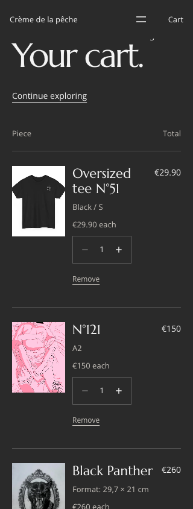
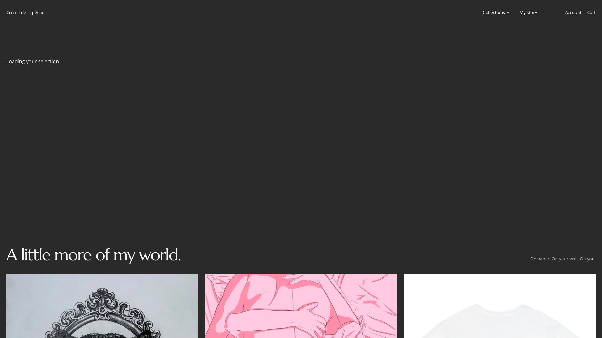

# Recette responsive et panier — 17 novembre 2026

## Environnement et résultat

Version de production locale (`next build` puis `next start`), Chrome headless
dans des sessions isolées, avec le catalogue et les mutations de panier Shopify
réels. Aucune commande ni aucun paiement n’a été effectué. Les sélections des
scénarios terminés ont été vidées ; les sessions de navigateur de test ont été fermées.

| Vérifications | Résultat |
| --- | --- |
| Responsive : 8 pages dans 7 formats, puis menu, FAQ, réduction des animations, confidentialité et 404 | 62/62 |
| Scénarios panier, erreurs réseau, cookie, onglets et checkout | 24/24 |
| Interactions supplémentaires : pagination, clavier, galerie, quantités invalides et petits écrans | 10/10 |
| Chargement des images principales de trois types de produits sur mobile et ordinateur | 6/6 |
| Tests de logique des services et de validation Shopify | 30/30 |
| Build et TypeScript | Réussis |
| ESLint | Aucune erreur ; un avertissement préexistant dans postcss.config.mjs |

## Couverture responsive

Formats : 320×740, 390×844, 768×1024, 844×390 (paysage), 1440×900,
1920×1080 et 2560×1440. Contrôle supplémentaire de la hero et du menu à 320×568.

Pages : accueil, artworks, prints, vêtements, fiche original, fiche print,
fiche vêtement et panier vide. Le panier rempli a aussi été contrôlé de 320 à
2560 px. Les trois images principales ont été attendues jusqu’à leur chargement
effectif, à 390 et 1920 px. Les contrôles de largeur n’ont détecté aucun
débordement horizontal sur les vues testées.

## Corrections effectuées

| Avant | Après |
| --- | --- |
| Une perte de réseau pendant une action client pouvait faire disparaître la fiche dans l’écran d’erreur Next.js | Les trois points d’entrée du panier affichent un message récupérable ; aucun nouvel essai automatique susceptible de doubler une modification |
| Une valeur de cookie malformée bloquait les nouveaux ajouts | La valeur est ignorée et un nouveau panier peut être créé ; les ID Shopify valides conservent leur clé intacte |
| Le point d’ancrage de la galerie fixe était placé à 24 px sous une navbar de 80 px | Galerie ancrée à 104 px, en dehors du défilement normal à la fin de son conteneur |
| Le bouton à refocaliser était capturé après le début de l’action et pouvait déjà avoir perdu le focus | Le submitter est mémorisé lors de la soumission, avant la désactivation du formulaire ; retour clavier contrôlé après fermeture du dialogue |
| Information cookie seulement préparée dans une note, avec une durée de 10 jours | Section affichée dans Privacy policy ; durée de 7 jours partagée avec le code du cookie |

## Scénarios panier

- Panier vide sans bouton de paiement.
- Ajout d’un original ; confirmation ; ajout répété sans dépasser un exemplaire.
- Absence de sélecteur de quantité pour un original ; tentative de quantité 2
  modifiée dans le formulaire refusée par le serveur.
- Produit épuisé non ajoutable.
- Variantes de print et de vêtement ; rejet des quantités zéro, négatives,
  décimales et vides ; incrémentation, décrémentation et borne minimale.
- Totaux des lignes cohérents avec le sous-total.
- Cookie HttpOnly, Secure, SameSite=Lax ; expiration à 7 jours ; valeur absente
  de `document.cookie`.
- Conservation après rechargement et dans un second onglet ; isolation d’un autre visiteur.
- Coupure réseau lors d’un ajout sur fiche, d’un ajout rapide et d’une
  modification de quantité : interface conservée et panier inchangé après reprise.
- Onglet obsolète : une ligne supprimée dans l’autre onglet ne peut pas être modifiée.
- Suppression de toutes les lignes et retour à l’état vide.
- Cookie corrompu : nouveau panier utilisable.
- Retour en haut via View cart ; fermeture de la confirmation par Escape et
  retour du focus ; les contrôles de fond ne peuvent pas recevoir le focus
  pendant l’ouverture du dialogue natif.
- Endpoint checkout : origine étrangère refusée en 403 ; session vide renvoyée
  au panier ; panier rempli redirigé en HTTPS vers la destination Shopify en 303.
  Le test s’arrête à cette redirection, avant toute commande.

## Limites et points à contrôler à la mise en ligne

- Tests effectués avec Chrome et des tailles de viewport simulées. Ils ne
  remplacent pas un passage sur un iPhone/Safari et un Android réels.
- Certaines requêtes d’images secondaires vers le CDN Shopify ont expiré pendant
  les navigations en rafale. Les six contrôles explicites des images principales
  passent. Le comportement des images secondaires et le réseau devront être
  revus depuis l’hébergement final ; il ne s’agit pas d’une garantie de chargement
  de chacune des 309 fiches.
- Le compte client et le paiement restent hébergés chez Shopify. Le routage
  Account et checkout doit rester accessible lors du basculement de domaine.
- Cette recette fonctionnelle n’est pas un audit de sécurité exhaustif ni une
  certification de conformité. La durée de 7 jours est un choix de conception,
  pas une obligation réglementaire.

## Contrôle complémentaire des animations après rafraîchissement

Sur le build de production, huit vérifications passent à 1440×900 et à 390×844 :
initialisation des masques hors écran, déclenchement des textes au scroll,
dévoilement des images, rafraîchissement en haut, restauration au milieu de la
page, retour client depuis une collection, réduction des animations et absence
d’erreur JavaScript. Les positions et les masques sont contrôlés avant l’entrée
dans l’écran, pendant le mouvement et après sa fin.

L’initialisation attend désormais le retrait du loader et des dimensions non
nulles du contenu réellement affiché. Les spans des lignes et des masques sont
explicitement en display:block pour permettre le déplacement vertical.

## Captures

